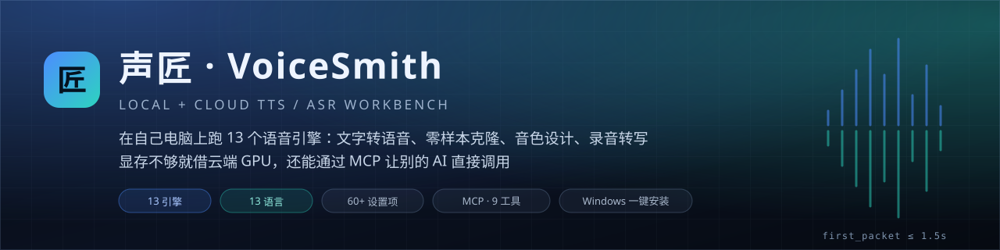
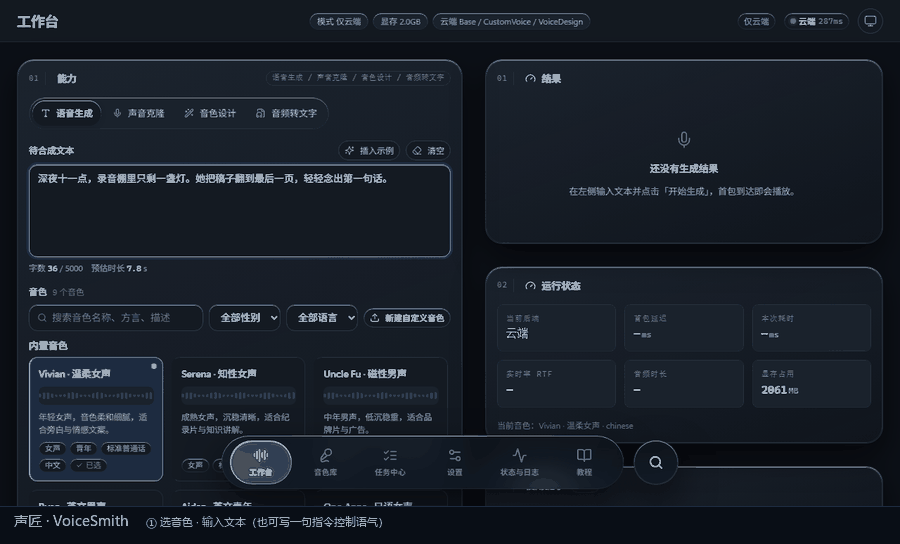
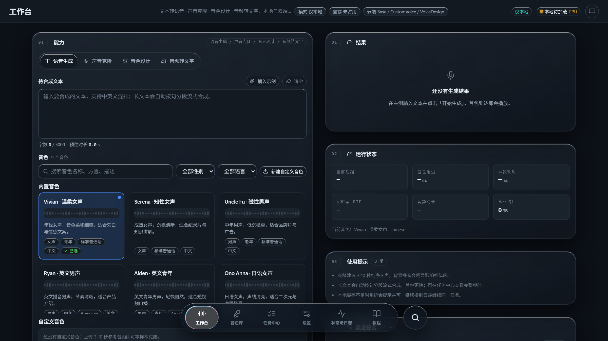
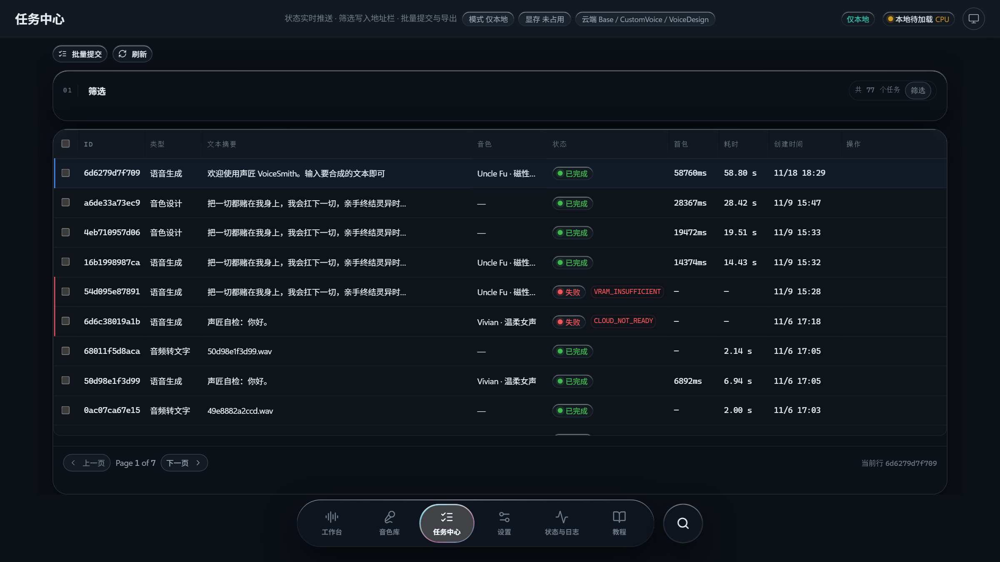
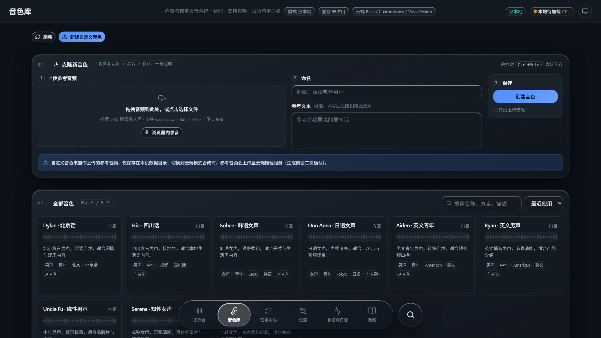
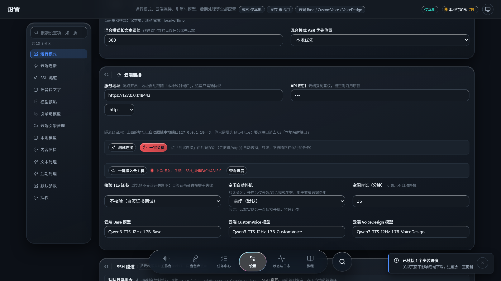
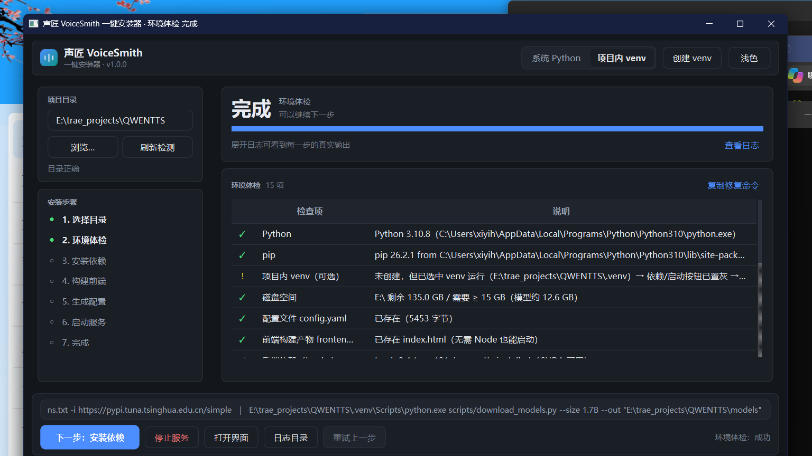
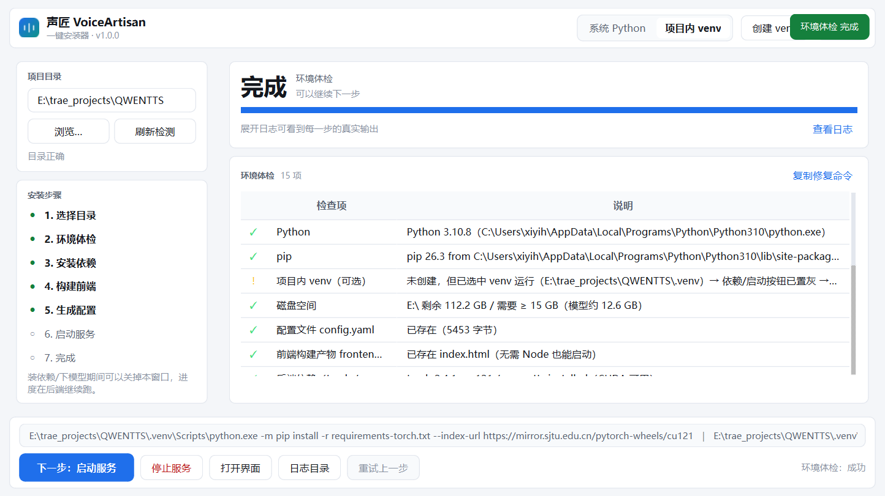
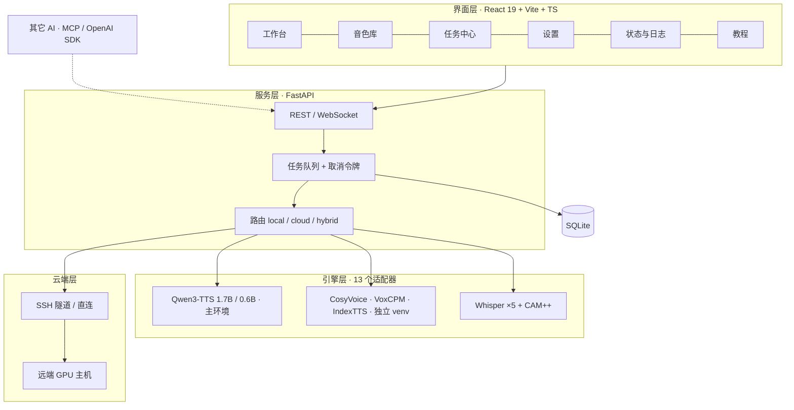

<div align="center">



**把「本地能跑、云端能借、别的 AI 能用」缝进同一个界面**

[](VERSION.json)
[](#快速开始)
[](#方式-b从源码运行)
[](frontend)
[](#支持的多引擎)
[](#给其它-ai-用mcp-server)
[](#验证与数字)
[](LICENSE)

[🔊 在线试听真实样本](docs/demo/) · [中文](#这是什么) · [English](#english) · [快速开始](#快速开始) · [文档](#文档索引) · [常见问题](#常见问题)

</div>

---

## 这是什么

**声匠 · VoiceArtisan** 是一套**跑在自己电脑上的语音工作台**：一个 Web 界面 + 一个本地后端，把 13 个语音模型（TTS / ASR / 声纹）编排在一起，同时保留一条通往云端 GPU 的路。

它解决三件事：

| 你原来的麻烦 | 这里的做法 |
| --- | --- |
| 装一个模型要配环境，换一个模型把环境搞崩 | 每个引擎独立 `.venv` + 精确版本锁文件，**主环境 torch 永不被替换**；装不上只影响该引擎 |
| 4GB 显卡被劝退，8GB 又不想浪费 | 显存先扣预留再判定，`float16` 让 **4GB 实测能跑 1.7B**；不够时一键切云端继续同一个任务 |
| 云端 GPU 只敢开一小时，关机全靠控制台 | 粘贴登录指令一键建隧道、S0–S8 十步接入向导、空闲自动停机、一键关机省费用 |

## 界面预览

<div align="center">

<br><sub>真机流程：选音色 → 输入文本 → 生成（进度回传）→ 波形与首包 / RTF / 显存</sub>
</div>

> **不想装？先听**：**[在线试听 5 段真实合成样本](docs/demo/)**（中文旁白、指令控制、英文、四川话、音色设计）——本机 GPU 直接生成，无后期处理。

<table>
<tr>
<td width="50%"></td>
<td width="50%"></td>
</tr>
<tr>
<td><b>工作台</b> — 四种能力、音色卡片、指令控制、流式播放与运行指标</td>
<td><b>任务中心</b> — 状态 / 首包 / 耗时、行内播放器、本地或云端重试、批量与导出</td>
</tr>
<tr>
<td width="50%"></td>
<td width="50%"></td>
</tr>
<tr>
<td><b>音色库</b> — 9 个内置音色 + 自建克隆，搜索 / 排序 / 试听 / 重命名</td>
<td><b>设置</b> — 13 个分区 60+ 可调项，搜索定位、字段级校验、0.7 秒自动保存</td>
</tr>
<tr>
<td width="50%"></td>
<td width="50%"></td>
</tr>
<tr>
<td colspan="2"><b>图形化启动器</b> — 免装 Python / PySide6：环境体检 → 依赖 → 前端 → 配置 → 模型 → 服务 → 打开界面，单一主按钮，日志可折叠</td>
</tr>
</table>

> 想一张图看懂全部功能？见 **[全功能总览图（5 张连续横屏）](docs/overview/)**。

## 亮点

| 方面 | 具体是什么 |
| --- | --- |
| **多引擎编排** | 13 个引擎走同一套适配器接口；新增引擎 = 写一个适配器 + 注册一行，路由 / API / MCP 自动支持 |
| **依赖隔离** | 除默认引擎就地推理外，其余引擎的依赖与 torch 关在 `<models_dir>/<engine_id>/.venv`，按 `locks/*.txt` 的 `pkg==x.y.z` 精确安装 |
| **显存策略** | 先扣「预留 GB」再判定；`float16` / `bfloat16` / `float32` 可选；允许 Windows 超额回落共享内存；0.6B 回退可禁止 |
| **快** | 模型预热 + 常驻，首个请求就快；空闲卸载可配秒级阈值；每次生成后回收显存 |
| **云端借算力** | 直连 / SSH 隧道 / 一键接入向导（S0–S8 可续跑，挂载模式跳过上传与装依赖）；空闲停机与一键关机 |
| **任务语义** | 取消令牌直达推理循环（不是改状态）、本地/云端双侧重试、批量逐行覆盖、字幕 SRT/VTT/ASS、按说话人拆分、3 档导出不覆盖原件 |
| **给 AI 用** | MCP Server 9 个工具（stdio），失败 `isError=true` 并带错误码；另有 OpenAI 兼容接口 |
| **能装上** | PySide6 图形启动器（PyInstaller onedir，免装 Python / PySide6）+ 纯 ASCII `start.bat`，便携包解压即用 |
| **说人话** | 21 条错误码都给中文提示与修复建议；设置里每个危险项都写明后果（停机 / 计费 / 耗时 / 显存） |

## 支持的多引擎

| 引擎 | 厂商 | 用途 | 备注 |
| --- | --- | --- | --- |
| **Qwen3-TTS 1.7B**（默认） | Qwen | 生成 · 克隆 · 设计 | fp16 约需 4.5GB 显存（4GB 可跑，见下） |
| Qwen3-TTS 0.6B | Qwen | 生成 · 克隆 | 小显存首选；音色设计仅 1.7B 提供 |
| Fun-CosyVoice3-0.5B | FunAudioLLM（阿里通义） | 克隆 · 指令 | 独立 venv |
| CosyVoice2-0.5B | FunAudioLLM | 克隆 · 预置音色 | 独立 venv |
| CosyVoice-300M-SFT | FunAudioLLM | 极轻量预置音色 | 独立 venv |
| VoxCPM1.5 | OpenBMB（面壁智能） | 克隆 | 独立 venv |
| IndexTTS-2 | bilibili Index | 克隆 · 情绪表现 | 独立 venv |
| Whisper ×5 | OpenAI / Systran | 转写 | Tiny 75MB → Large-V3 3.1GB |
| CAM++ 声纹 | 阿里 3D-Speaker | 说话人区分 | 供 SPK 分段使用 |

语言与口音 13 种：Auto / 中 / 英 / 日 / 韩 / 法 / 德 / 西 / 意 / 葡 / 俄 / 北京话 / 四川话。内置音色 9 个（Vivian、Serena、Uncle Fu、Ryan、Aiden …）。

## 三种运行模式

| 模式 | 干什么 | 什么时候用 |
| --- | --- | --- |
| `local` | 全部任务用本机 GPU / CPU | 断网、隐私敏感、零 API 成本 |
| `cloud` | 全部任务走云端 GPU（HTTPS + API Key） | 没有独显，或不想让本机跑满 |
| `hybrid` | 按任务与显存自动选址；长文本超阈值优先云端 | 两边都有，想「能本地就本地」 |

---

## 快速开始

### 方式 A：图形启动器（推荐给非开发者）

1. 下载便携包，解压到任意目录
2. 双击根目录 `start.bat`
3. 启动器先跑**环境体检**，然后按提示点唯一的主按钮：装依赖 → 装前端产物 →（在「引擎与模型」里下载模型）→ 启动服务
4. 浏览器自动打开 `https://localhost:8443`（自签证书：点「高级 → 继续前往」）

> `start.bat` 会优先拉起 Qt 版启动器（`launcher/dist-qt/VoiceArtisan-Setup-Qt/VoiceArtisan-Setup-Qt.exe`，免装 Python 与 PySide6），找不到才退回旧版 `launcher/dist/VoiceArtisan-Setup.exe`。细节见 [LAUNCHER](docs/LAUNCHER.md)。

### 方式 B：从源码运行

```powershell
# Windows（首次会安装依赖并构建前端）
.\scripts\start.ps1
```

```bash
# Linux / macOS
./scripts/start.sh
```

手动跑后端：

```bash
cd backend
python -m app.main --no-browser      # 默认 https://localhost:8443
python -m app.main --selfcheck       # 启动自检
```

**没有模型也能先看界面**：把 `config/config.yaml` 的 `mock.enabled` 设为 `true`，使用占位引擎联调（界面会标注「模拟引擎」）。

### 模型下载（本仓库不自动下载）

```bash
python scripts/download_models.py --links   # 打印国内可访问链接与目标目录
python scripts/download_models.py           # 或从 ModelScope 直连下载（约 12.6GB）
```

放到 `models/Qwen3-TTS-12Hz-1.7B-{Base,CustomVoice,VoiceDesign}/`，然后 `cd backend && python -m app.main --selfcheck` 校验。各引擎的链接、体积与目录要求见 **[docs/MODELS.md](docs/MODELS.md)**。

### 硬件与实测

| 场景 | 结论 |
| --- | --- |
| 4GB 显卡（RTX 3050 Laptop 实测） | 1.7B **能跑**：`dtype: float16` + `vram_reserve_gb: 0.1` + `allow_vram_overcommit: true`，靠 WDDM 共享内存小幅超额（峰值 4049MB），三种能力实测 RTF 0.08–0.21、首包 9–25s |
| 独显被桌面 / 浏览器占用 | 可能 OOM → 返回 `VRAM_INSUFFICIENT`，界面可「一键切换到云端」继续同一任务 |
| 无独显 | `local.device: cpu`（功能完整，约慢 3–5 倍）；或直接 `run.mode: cloud` |
| 建议 | CPU 模式 16GB 内存起；磁盘给模型留约 10GB |

> `local.low_vram`（CPU/磁盘 offload）默认关闭：`qwen-tts 0.1.1` 的生成循环不兼容 accelerate offload。默认**不会**降级到 0.6B，需显式 `allow_small_fallback: true`。

配置预设可直接用：`config/config.local-gpu.example.yaml`、`config/config.cloud-only.example.yaml`。

### 部署选一条路

| 你的情况 | 推荐路线 | 看这篇 |
| --- | --- | --- |
| 有 NVIDIA 显卡（≥8GB），想全本地 | `run.mode: local` + 1.7B 三件套 | [QUICKSTART](docs/QUICKSTART.md) |
| 只有 4GB 显存 | 本地 `float16` 直接跑 1.7B，或切云端 | [MODELS §4](docs/MODELS.md) |
| 没有独显 / 不想占本机资源 | 云端 GPU + 本地只当界面 | [CLOUD_SETUP](docs/CLOUD_SETUP.md) |
| 想两边都用、自动择优 | `run.mode: hybrid` | [CONFIG](docs/CONFIG.md) |
| 想用鼠标点完安装 | 图形启动器 | [LAUNCHER](docs/LAUNCHER.md) |
| 要部署成长期服务 | systemd / Windows 服务 / 反代 / 备份升级 | [DEPLOY](docs/DEPLOY.md) |

---

## 云端 GPU

三种连法，同一种体验：

1. **直连** — 填 `https://host:8443` + API Key，适合有公网端口的实例
2. **SSH 隧道** — 粘贴平台给的整行登录指令（`ssh -p 13485 root@host`）→ 一键启用；本地 `18443` → 云端 `127.0.0.1:8443`，浏览器无感知
3. **一键接入向导** — 只给连接信息，自动布置源码 / 依赖 / 服务并写回本地配置

向导的十步状态机（每步可单独重跑；挂载模式可跳过 3 步）：

```
S0 参数校验 → S1 SSH 连通 → S2 环境体检 → S3 上传源码 → S4 安装依赖
   → S4B 下载模型 → S5 启动服务 → S6 就绪探测 → S7 写入本地配置 → S8 本地验收
```

省钱与排错：空闲自动停机（0–240 分钟）、一键关机（SSH `shutdown -h now`，平台停止计费）/ 仅停止服务（释放显存保留实例）；失败一律给错误码 + 中文提示 + 修复建议（`SSH_AUTH_FAILED` / `SSH_UNREACHABLE` / `SSH_HOSTKEY_CHANGED` / `REMOTE_PROJECT_MISSING`）。容器化云端部署见 [cloud/](cloud/)。

## 给其它 AI 用：MCP Server

```jsonc
{
  "mcpServers": {
    "voiceartisan": { "command": "voiceartisan-mcp", "cwd": "<项目根目录>" }
  }
}
```

| 工具 | 作用 |
| --- | --- |
| `tts_synthesize` | 同步合成，直接返回音频路径 |
| `tts_submit` | 异步提交，拿 `task_id` 轮询 |
| `asr_transcribe` / `asr_submit` | 同步 / 异步转写（可带说话人区分） |
| `task_status` / `task_cancel` | 查状态、进度、产物；取消任务 |
| `voice_list` / `voice_clone` / `voice_design` | 列音色、建克隆音色、自然语言造音色 |

```bash
python -m app.mcp_server --selftest      # 六步握手自测，确认能连再配客户端
```

约定：stdio 传输；失败时 `isError=true` 并带错误码；产物路径固定 `data/outputs/<task_id>/<file>`。完整说明与三种客户端写法见 **[docs/MCP.md](docs/MCP.md)**。

## OpenAI 兼容接口

现成的 OpenAI SDK / 客户端可以直接调用：

| 接口 | 说明 |
| --- | --- |
| `POST /v1/audio/speech` | 文本转语音（不支持 `stream`） |
| `POST /v1/audio/transcriptions` | 语音转文字 |
| `GET /v1/models` · `GET /v1/audio/voices` | 模型与音色列表 |
| `POST /v1/engine/asr` | 云端转写（含 `diarize` / `min_speakers` / `max_speakers`） |

字段与差异见 **[docs/API.md](docs/API.md)**。

## 架构



## 项目结构

```
QWENTTS/
├─ backend/app/                 FastAPI 后端
│  ├─ main.py                   HTTPS、静态前端、启动自检
│  ├─ engine/                   引擎注册表 · 安装编排 · 显存管理 · 路由
│  │  ├─ adapters/              13 个适配器 + 锁文件 + venv 隔离 + runner
│  │  └─ vram.py                显存探测 / 估算 / 回收
│  ├─ api/                      REST + WebSocket + 云端 /v1
│  ├─ worker.py                 任务队列（流式、取消、重试、显存回收）
│  ├─ tunnel.py                 SSH 端口转发（paramiko direct-tcpip）
│  ├─ cloud_agent.py            一键接入向导（S0–S8 状态机）
│  ├─ mcp_server.py             MCP Server（9 工具）
│  └─ db.py                     SQLite（任务 / 音色 / 资产）
├─ frontend/src/                React + TS
│  ├─ pages/                    工作台 / 音色库 / 任务中心 / 设置 / 状态与日志 / 教程
│  ├─ components/               播放器 · 波形 · 参数面板 · 引擎卡片 · 云端向导 …
│  └─ styles/                   设计令牌 + 布局 + 组件
├─ launcher/                    tk 兜底启动器 + PySide6 启动器 + 打包脚本
├─ cloud/                       Dockerfile + compose（云端部署）
├─ scripts/                    一键启动 · 模型下载 · 冒烟 / 基准 / UI 检查
├─ docs/                       接口 / 配置 / 部署 / MCP / 隔离 / 总览图
├─ models/                     模型目录（自行下载）
└─ data/                       运行期数据：SQLite、输出、日志、证书
```

## 验证与数字

| 项目 | 数值 | 怎么跑 |
| --- | --- | --- |
| 单元测试 | **114 passed** | `cd backend && python -m pytest tests` |
| 界面回归 | **24 项** | `python .cache/regression_check.py` |
| 接口冒烟 | 22 项 | `python scripts/smoke_test.py` |
| MCP 自检 | 6 步握手 | `python -m app.mcp_server --selftest` |
| TypeScript | 0 错误 | `cd frontend && npx tsc --noEmit` |
| 引擎 / 语言 / 音色 / 设置项 | 13 / 13 / 9 / 60+ | 见上表 |
| 启动器体检首行 | ≤0.5s | 启动器内「体检」 |

## 文档索引

| 文档 | 内容 |
| --- | --- |
| [QUICKSTART](docs/QUICKSTART.md) | 最快跑通一条路 |
| [RUN-TUTORIAL](docs/RUN-TUTORIAL.md) | 12 章运行教程（含包内路径） |
| [MODELS](docs/MODELS.md) | 各模型链接、体积、目录要求 |
| [CONFIG](docs/CONFIG.md) | 全部配置项与覆盖优先级 |
| [API](docs/API.md) | REST / WebSocket / 云端 /v1 / OpenAI 兼容 |
| [MCP](docs/MCP.md) | 9 个工具与三种客户端写法 |
| [CLOUD_SETUP](docs/CLOUD_SETUP.md) · [CLOUD_AGENT](docs/CLOUD_AGENT.md) | 云端连接与一键接入 |
| [ENGINE_ISOLATION](docs/ENGINE_ISOLATION.md) | 每引擎独立 venv 的原因与实现 |
| [LAUNCHER](docs/LAUNCHER.md) | 图形启动器的设计与交互 |
| [DEPLOY](docs/DEPLOY.md) · [TROUBLESHOOTING](docs/TROUBLESHOOTING.md) | 长期部署与排错 |
| [demo/](docs/demo/) | **在线试听**：5 段真实合成样本 + 复现命令 |
| [overview/](docs/overview/) | 全功能总览图（5 张横屏） |

界面内还内置了 **21 章教程页**（五分钟跑通 → 运行模式 → 云端与隧道 → 语音识别 → 引擎与预热 → 质检 / 文本 / 后期 → 导出与时长 → 批量 → MCP → 常见错误速查）。

## 常见问题

<details><summary><b>必须联网吗？</b></summary>

不需要。模型下载完之后，`run.mode: local` 全离线可用；云端 / 混合模式才需要网络，且只在合成时按需上传参考音频。
</details>

<details><summary><b>4GB 显卡真的能跑 1.7B？</b></summary>

能，已在本机 RTX 3050 Laptop 4GB 实测（`dtype: float16` + `vram_reserve_gb: 0.1` + `allow_vram_overcommit: true`，峰值 4049MB，RTF 0.08–0.21）。前提是桌面 / 浏览器不占独显；被占导致 OOM 会返回 `VRAM_INSUFFICIENT`，可一键切云端。
</details>

<details><summary><b>换引擎会不会把原来的环境搞坏？</b></summary>

不会。除默认引擎外，其余引擎的依赖与 torch 都装在各自 `.venv` 里，合成走 `runner.py` 子进程，主环境 torch 2.4.1+cu121 不会被任何安装动作替换。
</details>

<details><summary><b>为什么模型不随仓库发布？</b></summary>

体积（约 12.6GB）与许可都归发布方。本仓库只提供脚本与目录约定，下载后放到 `models/` 即可；`python scripts/download_models.py --links` 会打印国内可访问链接。
</details>

<details><summary><b>能把界面当纯客户端、后端放服务器吗？</b></summary>

可以：`run.mode: cloud` 时本机只做界面与调度，推理在云端 GPU；`cloud/` 里有 Dockerfile 与 compose。
</details>

## 许可与第三方

本项目采用**双轨许可**（source-available + 商业授权）：

| 使用场景 | 适用许可 | 费用 |
| --- | --- | --- |
| 个人学习、研究、非商业自用；修改与非商业分发 | **[LICENSE](LICENSE)**（PolyForm Noncommercial 1.0.0） | 免费 |
| 商业使用（企业内部生产、接单交付、集成进商业产品、对外提供服务） | **[LICENSE-COMMERCIAL.md](LICENSE-COMMERCIAL.md)** + [legal/LICENSE-EULA.txt](legal/LICENSE-EULA.txt) | 一次买断 |

- 商业授权为**一次性买断的使用权**，不转让著作权与源码所有权；不得基于本软件制作并公开发布新版本。
- 各模型权重由发布方授权（Qwen3-TTS / CosyVoice / VoxCPM / IndexTTS / Whisper / CAM++），商用以模型仓库页面为准；每个引擎卡片内标注了许可与来源。
- 第三方组件声明见 **[THIRD_PARTY_NOTICES.md](THIRD_PARTY_NOTICES.md)**。
- 数据默认全部留在本机 `data/`；密钥写入 `data/runtime.json`（SSH 密码 DPAPI 加密，界面脱敏）。

## 路线图

- [ ] 引擎插件化：第三方适配器按目录加载，不改主仓库
- [ ] 数据库迁移版本化（跨版本升级自动迁移）
- [ ] CI 门禁：pytest + `tsc` + 前端构建（当前为本地脚本）
- [ ] 多用户与权限（工作室场景）
- [ ] 内置音色清单的更新机制

---

<div align="center">

### 如果这个项目对你有用，点一个 ⭐ 就是最好的支持

问题与建议：提交 Issue ｜ 联系：`xiyihang360@163.com`

</div>

---

# English

<div align="center">

**VoiceArtisan — a local-first TTS / ASR workbench that can borrow a cloud GPU**

[](VERSION.json)
[](#english)
[](#supported-engines)
[](#mcp-server)
[](LICENSE)

[🔊 Listen to real samples](docs/demo/) · [中文](#这是什么) · [Quick start](#english-quick-start) · [Docs](#english-docs)

</div>

## What it is

VoiceArtisan is a **self-hosted speech workbench**: one React UI plus one FastAPI backend that orchestrates **13 engines** — text-to-speech, zero-shot voice cloning, voice design, transcription and speaker diarization — with an optional path to a **cloud GPU** when local VRAM is not enough.

Three problems it solves:

| Problem | How it is solved here |
| --- | --- |
| Installing a model wrecks the environment of the previous one | Every engine gets its own `.venv` with a pinned `pkg==x.y.z` lock file; **the host `torch` is never replaced**; a broken engine only breaks itself |
| "You need 8GB+ VRAM" | VRAM budget = free − reserve; `float16` makes 1.7B **run on a 4GB card** (measured), and one click moves the task to a cloud GPU |
| Cloud GPU costs are scary | One-liner SSH tunnel from a pasted login command, a resumable S0–S8 onboarding wizard, idle auto-shutdown and one-click power-off |

## Features

- **13 engines, one adapter interface** — Qwen3-TTS 1.7B / 0.6B, CosyVoice3 / 2 / 300M-SFT, VoxCPM1.5, IndexTTS-2, Whisper ×5, CAM++ speaker embedding. Adding an engine = one adapter + one registry line; routing, REST API and MCP pick it up automatically.
- **Real cancellation & retries** — a cancel token reaches the inference loop (not just a status flip); retry a failed task locally **or** on the cloud with the original parameters.
- **Streaming first** — sentence-level chunking over WebSocket, the first packet plays while the rest is still generating; `chunk_chars` trades latency for smoothness.
- **Everything is a task** — list / filter / search, inline player, batch submit with per-row overrides, subtitle export (SRT / VTT / ASS with an optional `[SPKn]` prefix), split-by-speaker, and three export tiers that never overwrite the lossless source.
- **Cloud without hand-holding** — paste `ssh -p 13485 root@host` to build a tunnel, or let the wizard validate → connect → inspect → upload → install → start → probe → write config → verify, rerunning any single step.
- **MCP server (9 tools)** — `tts_synthesize`, `tts_submit`, `asr_transcribe`, `asr_submit`, `task_status`, `task_cancel`, `voice_list`, `voice_clone`, `voice_design`. Failures return `isError=true` with an error code.
- **OpenAI-compatible endpoints** — `/v1/audio/speech`, `/v1/audio/transcriptions`, `/v1/models`, `/v1/audio/voices` (no `stream` support).
- **Installable by humans** — PySide6 launcher packaged as an onedir build (no Python / PySide6 required): health checks → deps → frontend → config → models → service → open UI, one primary button, collapsible log.
- **Honest errors** — 21 error codes with hints and next actions; dangerous settings spell out their consequences (billing, latency, VRAM).

## Supported engines

| Engine | Vendor | Capability |
| --- | --- | --- |
| **Qwen3-TTS 1.7B** (default) | Qwen | generate · clone · design |
| Qwen3-TTS 0.6B | Qwen | generate · clone (design needs 1.7B) |
| Fun-CosyVoice3-0.5B · CosyVoice2-0.5B · CosyVoice-300M-SFT | FunAudioLLM | clone · instruct · preset voices |
| VoxCPM1.5 | OpenBMB | clone |
| IndexTTS-2 | bilibili Index | clone, expressive |
| Whisper Tiny → Large-V3 | OpenAI / Systran | transcription (75MB → 3.1GB) |
| CAM++ | Alibaba 3D-Speaker | speaker diarization |

13 languages / accents (including Beijing and Sichuan dialect), 9 built-in voices.

## English quick start

**Option A — GUI launcher (no Python needed)**

1. Unzip the portable package
2. Run `start.bat` → it opens the Qt launcher
3. Follow the single primary button: deps → frontend → models → start service
4. `https://localhost:8443` opens automatically (self-signed cert → "Advanced → Proceed")

**Option B — from source**

```powershell
.\scripts\start.ps1                     # Windows: installs deps + builds frontend
```

```bash
./scripts/start.sh                      # Linux / macOS
cd backend && python -m app.main --no-browser
python -m app.main --selfcheck
```

**Models are not downloaded by this repo** (≈12.6GB, licensed by their publishers):

```bash
python scripts/download_models.py --links   # print China-accessible links + target dirs
python scripts/download_models.py           # or download from ModelScope
```

Put them under `models/Qwen3-TTS-12Hz-1.7B-{Base,CustomVoice,VoiceDesign}/`. See **[docs/MODELS.md](docs/MODELS.md)**.

**Hardware**: a 4GB card runs 1.7B with `dtype: float16` + `vram_reserve_gb: 0.1` + `allow_vram_overcommit: true` (measured peak 4049MB, RTF 0.08–0.21, first packet 9–25s). No GPU → `local.device: cpu`; or `run.mode: cloud` and let a remote GPU do the work. ~10GB disk for models, 16GB RAM recommended for CPU mode.

**Run modes**: `local` (offline, zero API cost) · `cloud` (HTTPS + API key) · `hybrid` (auto-select by task and VRAM).

## MCP server

```jsonc
{
  "mcpServers": {
    "voiceartisan": { "command": "voiceartisan-mcp", "cwd": "<repo root>" }
  }
}
```

```bash
python -m app.mcp_server --selftest    # 6-step handshake check
```

stdio transport · failures set `isError=true` with an error code · artifacts always land in `data/outputs/<task_id>/<file>`. See **[docs/MCP.md](docs/MCP.md)**.

## Architecture

```
React 19 UI  ──REST / WS──▶  FastAPI
                              ├─ task queue + cancel token ─▶ router
                              │                                ├─ local adapters (13 engines)
                              │                                └─ SSH tunnel / direct ─▶ cloud GPU
                              ├─ SQLite (tasks, voices, assets)
                              └─ MCP (stdio) + OpenAI-compatible /v1
```

## Verification

| Item | Value |
| --- | --- |
| Unit tests | 114 passed (`cd backend && python -m pytest tests`) |
| UI regression | 24 checks |
| API smoke | 22 checks |
| MCP selftest | 6 steps |
| TypeScript | 0 errors (`npx tsc --noEmit`) |

## English docs

[QUICKSTART](docs/QUICKSTART.md) · [MODELS](docs/MODELS.md) · [CONFIG](docs/CONFIG.md) · [API](docs/API.md) · [MCP](docs/MCP.md) · [CLOUD_SETUP](docs/CLOUD_SETUP.md) · [ENGINE_ISOLATION](docs/ENGINE_ISOLATION.md) · [LAUNCHER](docs/LAUNCHER.md) · [DEPLOY](docs/DEPLOY.md) · [TROUBLESHOOTING](docs/TROUBLESHOOTING.md) · [Demo samples](docs/demo/) · [Overview posters](docs/overview/)

Most documents are written in Chinese and the interface is Chinese-first; issues and PRs in English are welcome.

## License

**Dual licensing (source-available + commercial):**

| Use case | License | Cost |
| --- | --- | --- |
| Personal, educational, research and other **noncommercial** use, including modification and noncommercial redistribution | **[LICENSE](LICENSE)** — PolyForm Noncommercial 1.0.0 | Free |
| **Commercial use** (in-house production, client work, embedding into a product or service, paid hosting) | **[LICENSE-COMMERCIAL.md](LICENSE-COMMERCIAL.md)** + [legal/LICENSE-EULA.txt](legal/LICENSE-EULA.txt) | One-time buyout |

The commercial license grants a perpetual **right to use** only; it transfers neither copyright nor source ownership, and you may not publicly distribute new versions built from this software. Model weights remain under their publishers' licenses; see **[THIRD_PARTY_NOTICES.md](THIRD_PARTY_NOTICES.md)**. All data stays in local `data/`; secrets live in `data/runtime.json` (SSH passwords encrypted with Windows DPAPI).
